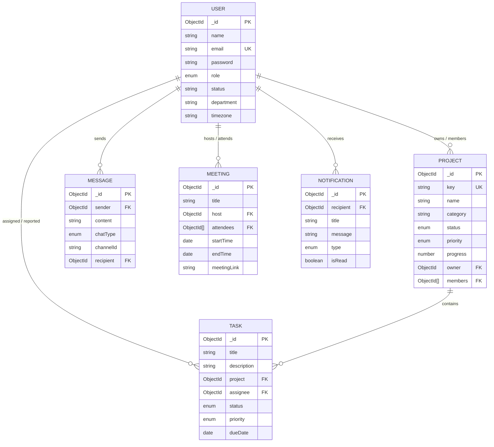

# TeamSync — System Architecture Document

This document outlines the architectural principles, system topology, component hierarchies, and data schema relationships for the **TeamSync** platform.

---

## 1. Architectural Principles

1. **Separation of Concerns**: Strict decoupling between client presentation (`client/`) and business API logic (`server/`).
2. **Resilience by Default**: Graceful degradation when external services (such as MongoDB Atlas) are temporarily offline or unconfigured during local developer onboarding.
3. **Convention over Configuration**: Standardized directory structures and uniform API response envelopes (`ApiResponse.js`).
4. **Design System Consistency**: Reusable atomic UI components (`Badge`, `Button`, `Card`, `Modal`, `PageHeader`) driven by centralized Tailwind theme tokens.

---

## 2. System Topology

```
                  ┌───────────────────────────────┐
                  │          Web Browser          │
                  │   (React 18 + Vite + SPA)     │
                  └──────────────┬────────────────┘
                                 │ HTTP (REST)
                                 ▼
                  ┌───────────────────────────────┐
                  │      Express Application      │
                  │      (Node.js v18+/v22+)      │
                  ├───────────────────────────────┤
                  │ Middlewares:                  │
                  │  - CORS (Domain whitelisting) │
                  │  - express.json()             │
                  │  - Centralized Error Handler  │
                  └──────────────┬────────────────┘
                                 │
                   Mongoose ODM  │ Connection Pooling
                                 ▼
                  ┌───────────────────────────────┐
                  │      MongoDB Atlas Cluster    │
                  │      (Users, Projects, Tasks) │
                  └───────────────────────────────┘
```

---

## 3. Data Model Architecture & Relationships



---

## 4. Frontend Component Hierarchy

```
App.jsx (React Router DOM)
 └── Layout.jsx
      ├── Sidebar.jsx (Responsive Navigation, Sprint Widget, Profile Footer)
      ├── Topbar.jsx (Search Bar, API Health Ping, Notifications Dropdown)
      ├── <Outlet /> (Main Page Render)
      │    ├── Dashboard.jsx (KPIs, Project Progress, Quick Tasks, Activity)
      │    ├── Projects.jsx (Grid Portfolio, Filters, New Project Modal)
      │    ├── Tasks.jsx (Kanban Board, List View, Move Controls, Add Task Modal)
      │    ├── TeamChat.jsx (Channels & DMs, Message Feed, Reaction System)
      │    ├── Meetings.jsx (Calendar Sync Cards, Schedule Modal, Join Links)
      │    ├── TeamMembers.jsx (Member Directory, Presence Status, Invite Modal)
      │    └── Settings.jsx (Profile, MongoDB Atlas Guides, Live API Ping)
      └── Modal.jsx (Global Task & Project Creation Dialogs)
```

---

## 5. MongoDB Atlas Connection Lifecycle

The connection handler in `server/config/db.js` enforces safe initialization:
1. Validates the existence of `process.env.MONGODB_URI`.
2. Checks for unreplaced placeholder tokens (e.g. `<username>`, `<password>`).
3. If unconfigured, emits an informative terminal warning and flags `getConnectionStatus()` as `'disconnected'`. The server remains operational so developers can inspect UI routes and health checks immediately.
4. If configured, establishes connection with a 5000ms server selection timeout and monitors state transitions (`connecting`, `connected`, `disconnected`).

---

## 6. Future Expansion Roadmap

- **Phase 2**: JWT Authentication & Role-Based Access Control (RBAC).
- **Phase 3**: Socket.IO integration for live channel chat and presence indicators.
- **Phase 4**: WebRTC / Agora integration for embedded TeamSync video meetings.
- **Phase 5**: Redis caching for dashboard metrics and task drag-and-drop state.
